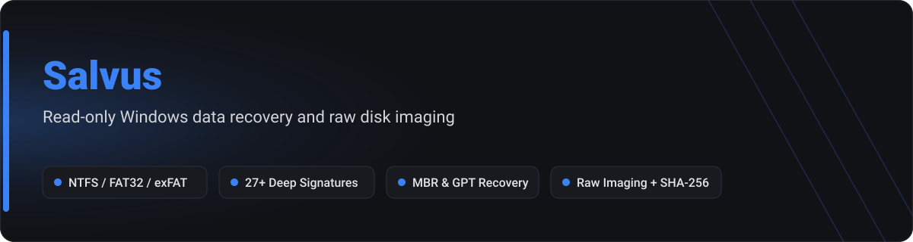
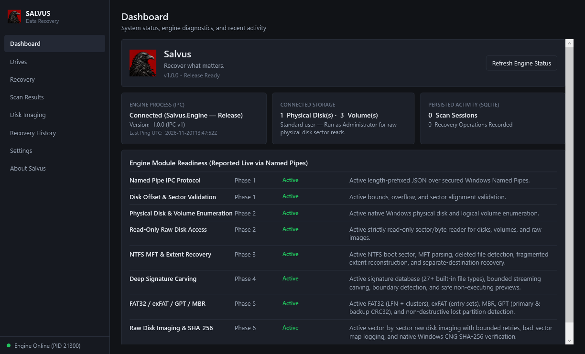
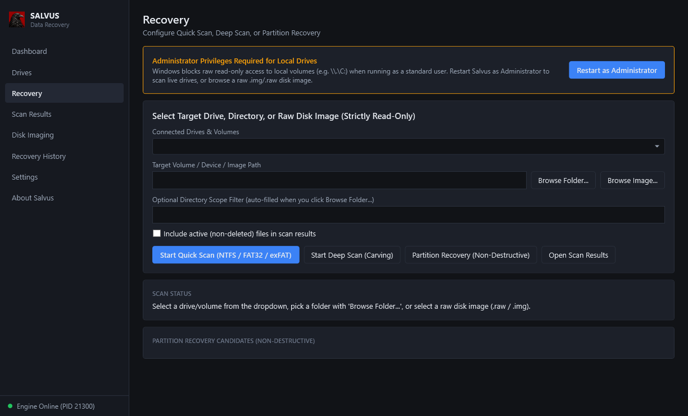
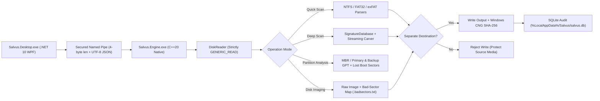

<div align="center">


# Salvus

Open-source Windows data recovery and raw disk imaging tool backed by a strictly read-only C++20 engine and a .NET 10 WPF desktop interface.


<br /><br />



<br /><br />

[Features](#features) • [Screenshots](#screenshots) • [How it works](#how-it-works) • [Installation](#installation) • [Usage](#usage) • [Configuration](#configuration) • [Troubleshooting](#troubleshooting)

</div>

## About

Salvus is a local, offline-only Windows 10/11 (x64) data recovery application that isolates low-level storage access in a native C++20 engine (`Salvus.Engine.exe`) separate from its dark-themed .NET 10 WPF interface (`Salvus.Desktop.exe`). The two processes communicate exclusively over a user-scoped Windows Named Pipe (`PIPE_REJECT_REMOTE_CLIENTS` with a current-user SID DACL) using 4-byte length-prefixed UTF-8 JSON frames capped at 16 MiB. Source drives, volumes, and raw disk images are opened strictly read-only (`GENERIC_READ`, `OPEN_EXISTING`); Salvus never modifies source media and enforces separate-destination validation before writing any recovered file or raw image. Scan sessions, discovered metadata, user preferences, and SHA-256 recovery audit records are persisted locally in SQLite (`%LocalAppData%\Salvus\salvus.db`), while raw physical disk and local volume scans require Windows Administrator privileges.

## Features

- **Isolated C++20 Engine & Secured Named Pipe IPC** — `Salvus.Engine.exe` runs as a separate native process so malformed file-system structures cannot crash the WPF UI or corrupt session state.
- **Native Device & Volume Enumeration** — Lists physical disks via SetupAPI (`GUID_DEVINTERFACE_DISK`) and storage IOCTLs alongside logical volumes mapped to their parent `PhysicalDriveN` indices.
- **Unified Quick Scan (NTFS, FAT32, exFAT)** — Auto-detects file systems and parses NTFS MFT records (USA fixups, resident/fragmented signed delta-LCN runs, sparse runs, Alternate Data Streams), FAT32 (8.3 + Long File Names, `0xE5` deleted entries), and exFAT (`File`/`StreamExtension`/`FileName` sets, `NoFatChain` and FAT chains) with explicit confidence classifications (`High`, `Medium`, `Low`, `Damaged`, `Unrecoverable`).
- **Signature-Based Deep Scan (27+ Built-In Types)** — Streams media in bounded 4 MiB buffers with a 256 KiB footer search window across images, video, audio, documents, archives, and PE binaries, including BMP/RIFF size parsing and ZIP EOCD boundary detection.
- **Safe Non-Executing Previews** — Renders in-memory Base64 image previews, sanitized UTF-8/ASCII text snippets, and PDF header metadata without executing or writing previewed files to disk.
- **Non-Destructive Partition Recovery** — Inspects MBR partition tables, primary and backup GPT headers with CRC32 verification, and scans unallocated regions for lost partition boot sectors without altering partition tables.
- **Raw Disk Imaging & Native CNG SHA-256** — Creates sector-by-sector raw disk images with bounded bad-sector retries (up to 5), zero-filled LBA preservation, persistent `.badsectors.txt` logs, and streaming SHA-256 verification via Windows CNG (`bcrypt.dll`).
- **Separate-Destination Enforcement & SQLite Audit History** — Blocks recovering files or writing disk images onto the same source image, volume, or physical disk, and logs every recovery operation with its SHA-256 digest in SQLite.

## Screenshots

<p align="center">
  
  <br />
  <em>Dashboard displaying live Named Pipe engine status, connected storage summary, and per-module readiness.</em>
</p>

<p align="center">
  
  <br />
  <em>Recovery view for selecting a physical drive, volume, folder scope, or raw disk image for Quick Scan, Deep Scan, or Partition Recovery.</em>
</p>

## How it works



## Installation

### Prerequisites (Build from Source)

- **OS:** Windows 10 or Windows 11 (x64)
- **C++ Toolchain:** Visual Studio 2022 (or Build Tools 2022) with **Desktop development with C++** (MSVC v143, Windows 10/11 SDK, CMake 3.24+)
- **.NET SDK:** .NET 10 SDK (`10.0.x`)

### Build Steps

1. **Build the native C++20 recovery engine (`Salvus.Engine`):**

```powershell
cmake -S Salvus.Engine -B Salvus.Engine/build -G "Visual Studio 17 2022" -A x64
cmake --build Salvus.Engine/build --config Release
```

This produces `Salvus.Engine/build/Release/Salvus.Engine.exe`.

2. **Build the .NET 10 desktop solution (`Salvus.sln`):**

```powershell
dotnet restore Salvus.sln
dotnet build Salvus.sln -c Release --no-restore
```

`Salvus.Desktop.csproj` automatically copies `Salvus.Engine.exe` alongside `Salvus.Desktop.exe` when a built engine binary exists in `Salvus.Engine/build/<Configuration>/`.

### Windows Installer

An Inno Setup 6 x64 installer definition is located at `installer/Salvus.iss` and is built automatically by `.github/workflows/release.yml` for tagged releases.

## Usage

### Desktop Application

Launch `Salvus.Desktop.exe` from `Salvus.Desktop\bin\x64\Release\net10.0-windows\win-x64\Salvus.Desktop.exe`, or use the included helper script:

```powershell
.\run-dev.cmd
```

1. **Dashboard** — Confirm `Salvus.Engine` is online and verify module readiness.
2. **Drives** — Inspect physical disks and logical volumes; click a target to send it to **Recovery**.
3. **Recovery** — Choose a connected volume/disk (requires Administrator privileges) or browse a `.raw`/`.img` disk image, then run **Start Quick Scan (NTFS / FAT32 / exFAT)**, **Start Deep Scan (Carving)**, or **Partition Recovery (Non-Destructive)**.
4. **Scan Results** — Filter discovered files by name or confidence, inspect safe non-executing previews, and recover selected files to a separate destination drive or folder.
5. **Disk Imaging** — Create a sector-by-sector raw image of a drive or image file and verify SHA-256 checksums.

### Engine CLI Flags

`Salvus.Desktop.exe` starts `Salvus.Engine.exe` automatically, but the engine also supports direct CLI flags for diagnostics and integration testing:

```powershell
Salvus.Engine.exe --version
Salvus.Engine.exe --pipe Salvus.Engine.Custom
```

## Configuration

| Setting / Path | Default | Scope / Notes |
| --- | --- | --- |
| `read_buffer_mb` (Settings UI) | `4` MiB | Valid range: `1`–`64` MiB. Persisted in SQLite `user_preferences`. |
| Local SQLite Database | `%LocalAppData%\Salvus\salvus.db` | Stores `scan_sessions`, `scan_configurations`, `discovered_files` (metadata only), `recovery_history`, `recovery_reports`, and `user_preferences`. |
| Named Pipe Endpoint | `\\.\pipe\Salvus.Engine.<pid>.<guid>` | Per-instance pipe started by `EngineIpcClient`; standalone engine defaults to `\\.\pipe\Salvus.Engine`. |
| Max IPC Frame Size | `16 MiB` (`16,777,216` bytes) | Oversized or zero-length frames are rejected by both client and server. |
| Disk Imaging Sector Retries | `2` (bounded max `5`) | Failed sectors are zero-filled to preserve LBA alignment and logged to `<image>.badsectors.txt`. |

## Troubleshooting

- **Cannot scan live drives (`\\.\C:` or `\\.\PhysicalDriveN`)** — Windows blocks raw volume and physical disk reads for standard users. Click **Restart as Administrator** in the Recovery view or launch `Salvus.Desktop.exe` elevated. Scanning local `.raw`/`.img` disk image files works without elevation.
- **Dashboard shows `Engine Offline`** — Verify `Salvus.Engine.exe` has been built with CMake (`Salvus.Engine/build/Release/Salvus.Engine.exe`) and is present next to `Salvus.Desktop.exe`.
- **Recovery or imaging write is rejected** — Salvus intentionally blocks writing recovered files or disk images to the same source image, volume, or physical disk to prevent overwriting recoverable data. Select a destination on a different storage device.
- **`.NET 10` runtime not found when launching directly** — If `.NET 10` is installed per-user in `%USERPROFILE%\.dotnet`, launch via `run-dev.cmd` or set `DOTNET_ROOT=%USERPROFILE%\.dotnet` before starting `Salvus.Desktop.exe`.

## Documentation & License

- [Architecture](docs/ARCHITECTURE.md)
- [Build Instructions](docs/BUILD.md)
- [Testing Guide](docs/TESTING.md)
- [Dependency Inventory](docs/DEPENDENCIES.md)
- [Security Audit](docs/SECURITY_AUDIT.md)
- [Security Policy](SECURITY.md)
- [Contributing](CONTRIBUTING.md)
- [Changelog](CHANGELOG.md)

Salvus is licensed under the **GNU General Public License v3.0 or later** (`GPL-3.0-or-later`). See [LICENSE](LICENSE) for the full text.
